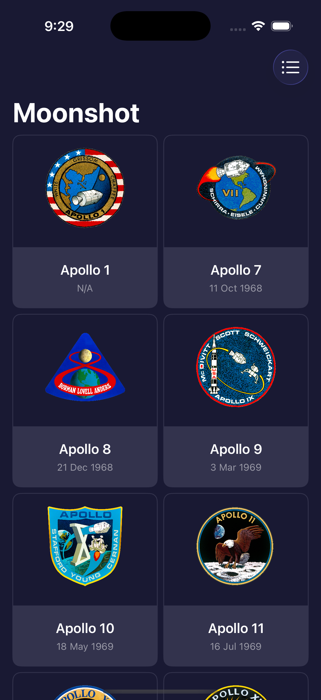
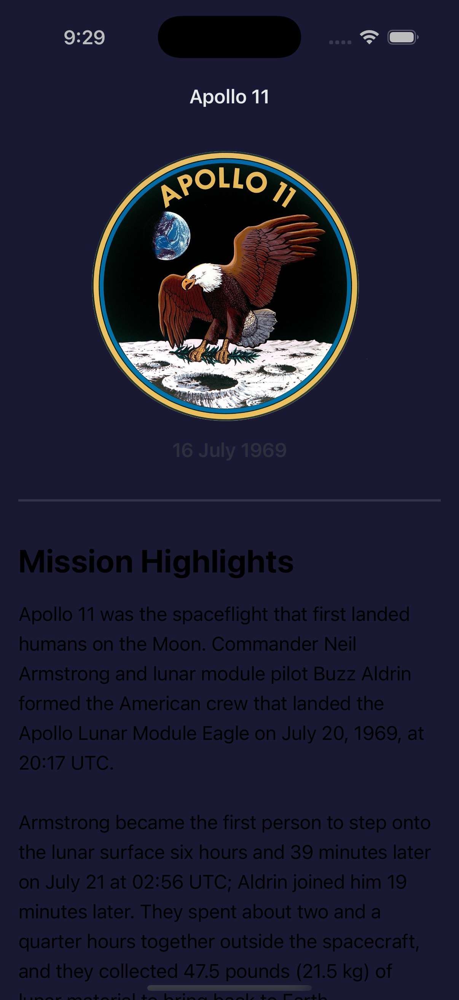

# 🚀 Moonshot - Apollo Space Missions

An iOS SwiftUI app displaying NASA's historic Apollo missions, crew members, and mission highlights. Built as part of Paul Hudson's **100 Days of SwiftUI** (Project 8), refactored into a clean, feature-driven production architecture, and fully solving all three wrap-up challenges.

---

## 📱 App Screenshots

| Grid View (Challenge 3) | List View (Challenge 3) | Mission Detail (Challenge 1 & 2) |
| :---: | :---: | :---: |
|  |  |  |

---

## 🎯 Wrap-Up Challenges Solved

### 1. Launch Date in `MissionView`
* **File:** `Moonshot/Features/MissionDetail/Views/MissionView.swift` & `Moonshot/Models/Mission.swift`
* Added `detailedLaunchDate` formatted with `.long` date style (e.g. *"July 16, 1969"* or *"N/A"* for missions without a launch date, like Apollo 1).
* Displayed prominently underneath the mission badge with `.font(.headline)` and `.foregroundStyle(.secondary)`.

### 2. Subview Extraction
* **Components Extracted:**
  * `CustomDivider`: Extracted repeated `Rectangle().frame(height: 2)...` dividers into a reusable design component (`Core/Components/CustomDivider.swift`).
  * `MissionCrewView`: Extracted the horizontal crew scrolling list into a dedicated subview (`Features/MissionDetail/Views/MissionCrewView.swift`).
  * `CrewMemberCard`: Extracted the astronaut capsule card component (`Features/MissionDetail/Components/CrewMemberCard.swift`).
* Simplifies `MissionView.swift` down to high-level declarative composition.

### 3. Grid vs. List View Toggle
* **File:** `Moonshot/Features/Missions/Views/ContentView.swift`
* Extracted `MissionGridView` and `MissionListView` along with reusable `MissionGridCell` and `MissionListRow` components.
* Persists user preference across launches using `@AppStorage("showingGrid")`.
* Added a `.toolbar` toggle with dynamic SF Symbols (`square.grid.2x2` / `list.bullet`).
* `MissionListView` features `.scrollContentBackground(.hidden)` and `.listRowBackground(Color.darkBackground)` to blend seamlessly with the space theme.

---

## 📁 Production Directory Structure

```text
Moonshot/
├── App/
│   └── MoonshotApp.swift                          # @main App entry point
├── Core/
│   ├── Extensions/
│   │   ├── Bundle-Decodable.swift                 # Diagnostic-rich JSON decoder with folder fallback
│   │   └── Color-Theme.swift                      # ShapeStyle & Color semantic tokens
│   └── Components/
│       └── CustomDivider.swift                    # [Challenge 2] Reusable styled divider
├── Models/
│   ├── Astronaut.swift                            # Astronaut domain model
│   └── Mission.swift                              # Mission model + [Challenge 1] launch date formatters
├── Features/
│   ├── Missions/
│   │   ├── Views/
│   │   │   ├── ContentView.swift                  # [Challenge 3] Container with @AppStorage & toolbar toggle
│   │   │   ├── MissionGridView.swift              # [Challenge 3] Adaptive LazyVGrid layout
│   │   │   └── MissionListView.swift              # [Challenge 3] Styled vertical List layout
│   │   └── Components/
│   │       ├── MissionGridCell.swift              # Extracted grid cell component
│   │       └── MissionListRow.swift               # Extracted list row component (single chevron)
│   ├── MissionDetail/
│   │   ├── Views/
│   │   │   ├── MissionView.swift                  # [Challenge 1 & 2] Detail screen with date under badge
│   │   │   └── MissionCrewView.swift              # [Challenge 2] Extracted horizontal crew scroll view
│   │   └── Components/
│   │       └── CrewMemberCard.swift               # Extracted capsule astronaut card
│   └── AstronautDetail/
│       └── Views/
│           └── AstronautView.swift                # Astronaut portrait & description screen
├── Resources/
│   ├── Assets.xcassets                            # Badges, astronaut portraits, colors
│   └── Data/
│       ├── astronauts.json                        # NASA astronaut dataset
│       └── missions.json                          # Apollo mission dataset
└── screenshots/
    ├── grid_view.png                              # App grid view screenshot
    ├── list_view.png                              # App list view screenshot
    └── detail_view.png                            # Mission detail view screenshot
```

---

## 🛠️ Requirements & Setup

* **iOS:** 17.0+
* **Xcode:** 15.0+ / 16.0+
* **Swift:** 5.9+ / 6.0
* Open `Moonshot.xcodeproj` in Xcode and press `Cmd + R` to run on any simulator or device.
